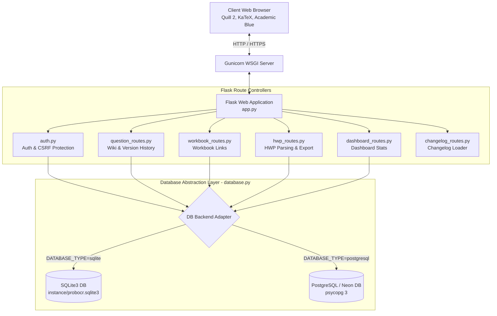
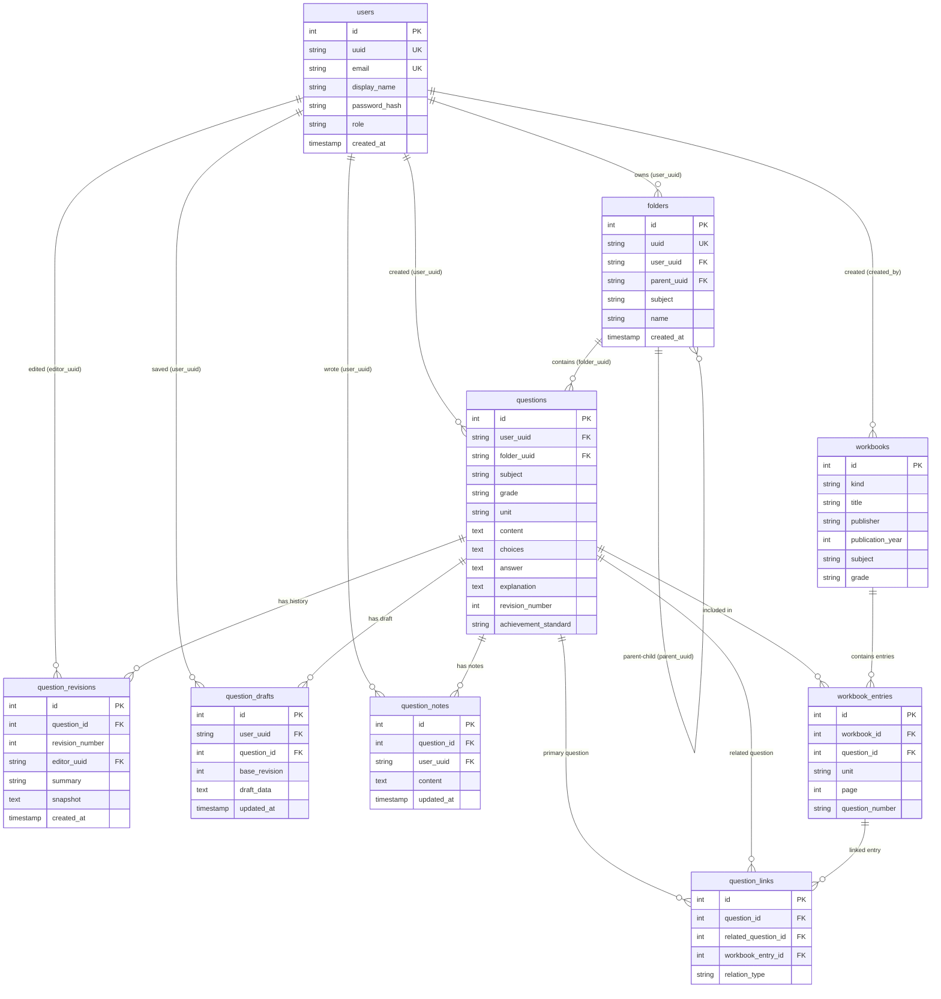

# HEXORA (헥소라) 종합 문서 - 2. 시스템 아키텍처 및 데이터베이스 스키마

이 문서는 HEXORA 애플리케이션의 시스템 아키텍처, 데이터베이스 어댑터 설계 및 9개 테이블의 세부 스키마와 인덱스 구조를 설명합니다.

---

## 1. 시스템 아키텍처 (System Architecture)

HEXORA는 플라스크(Flask) 기반의 렌더링 프레임워크와 이중 데이터베이스 레이어(Database Abstraction Layer)로 구성되어 있습니다.



---

## 2. 데이터베이스 ERD (Entity Relationship Diagram)

HEXORA 9개 테이블 간의 관계를 표현한 ERD입니다:



---

## 3. 데이터베이스 어댑터 구현 (`database.py`)

HEXORA는 `DATABASE_TYPE` 환경 변수를 사용하여 개발용 SQLite3와 배포용 PostgreSQL(Neon)을 동일한 비즈니스 로직으로 구동할 수 있도록 데이터베이스 어댑터 래퍼(Wrapper)를 제공합니다.

### 3.1 주요 어댑터 클래스 및 함수

1. **`get_db()` & `close_db()`**:
   - Flask의 애플리케이션 컨텍스트 `g` 객체를 활용해 요청당 단일 데이터베이스 연결을 유지합니다.
   - 요청 완료 시 `teardown_appcontext` 후크에 등록된 `close_db()`가 자동으로 연결을 닫거나 반환합니다.

2. **`_translate_qmark_placeholders(statement)`**:
   - SQLite 표준의 `?` 바인딩 파라미터 쿼리를 PostgreSQL의 `%s` 순차 파라미터 구문으로 변환합니다. 문자열 리터럴 내부의 `?` 문자는 오탐하지 않도록 따옴표 파싱을 적용합니다.

3. **`PostgresCursorWrapper` & `PostgresConnectionWrapper`**:
   - PostgreSQL 연결 시 `psycopg` 커서를 래핑하여, Dict-like 튜플 접근(`row["title"]` 또는 `row[0]`)이 가능하도록 `dict_row` 팩토리와 연동합니다.
   - `lastrowid` 구문을 지원하기 위해 `INSERT INTO ... RETURNING id` 형태의 ID 자동 추출 래핑을 지원합니다.

4. **`begin_write_transaction(connection, lock_table=None)`**:
   - SQLite에서는 `BEGIN IMMEDIATE` 구문으로 쓰기 락을 선점합니다.
   - PostgreSQL에서는 필요시 `LOCK TABLE <lock_table> IN EXCLUSIVE MODE`를 수행하여 가상 동시성 충돌을 방지합니다.

5. **`is_integrity_error(error)`**:
   - `sqlite3.IntegrityError`와 `psycopg.errors.IntegrityError`를 통합 감지하여 중복 가입, 외래키 제약조건 위반 등을 안전하게 처리합니다.

---

## 4. 데이터베이스 스키마 및 테이블 세부 명세

데이터베이스에는 총 **9개의 메인 테이블**과 관련 인덱스가 생성됩니다.

### 4.1 `users` (회원 테이블)
시스템 사용자 계정 정보 및 역할을 저장합니다.

| 컬럼명 | 타입 | 제약 조건 | 설명 |
| --- | --- | --- | --- |
| `id` | INTEGER / SERIAL | PRIMARY KEY AUTOINCREMENT | 고유 식별자 |
| `uuid` | VARCHAR(36) | UNIQUE NOT NULL | 계정 비공개 고유 UUID |
| `email` | VARCHAR(255) | UNIQUE NOT NULL | 이메일 (로그인 ID) |
| `display_name` | VARCHAR(100) | NOT NULL | 사용자 표시 이름 |
| `password_hash` | VARCHAR(255) | NOT NULL | Werkzeug pbkdf2/scrypt 비밀번호 해시 |
| `role` | VARCHAR(20) | NOT NULL DEFAULT 'user' | 역할 (`admin` 또는 `user`) |
| `created_at` | TIMESTAMP | DEFAULT CURRENT_TIMESTAMP | 가입 시각 |

### 4.2 `folders` (개인 폴더 테이블)
사용자별 문제 분류용 폴더 계층 구조를 저장합니다.

| 컬럼명 | 타입 | 제약 조건 | 설명 |
| --- | --- | --- | --- |
| `id` | INTEGER / SERIAL | PRIMARY KEY AUTOINCREMENT | 고유 식별자 |
| `uuid` | VARCHAR(36) | UNIQUE NOT NULL | 폴더 고유 UUID |
| `user_uuid` | VARCHAR(36) | NOT NULL, REFERENCES users(uuid) | 폴더 소유자 UUID |
| `parent_uuid` | VARCHAR(36) | REFERENCES folders(uuid) | 상위 폴더 UUID (NULL인 경우 최상위) |
| `subject` | VARCHAR(50) | NOT NULL | 관련 과목 |
| `name` | VARCHAR(100) | NOT NULL | 폴더 이름 |
| `created_at` | TIMESTAMP | DEFAULT CURRENT_TIMESTAMP | 생성 시각 |

### 4.3 `questions` (공개 문제 은행 테이블)
공동 문제 위키의 단일 원본 문항 데이터를 보관합니다.

| 컬럼명 | 타입 | 제약 조건 | 설명 |
| --- | --- | --- | --- |
| `id` | INTEGER / SERIAL | PRIMARY KEY AUTOINCREMENT | 고유 식별자 (6자리 Base36 변환 사용) |
| `user_uuid` | VARCHAR(36) | REFERENCES users(uuid) | 최초 원작성자 UUID |
| `folder_uuid` | VARCHAR(36) | REFERENCES folders(uuid) | 소유 폴더 UUID |
| `subject` | VARCHAR(50) | NOT NULL | 과목 (수학, 과학, 국어 등) |
| `grade` | VARCHAR(20) | NOT NULL | 대상 학년 (고1, 고2 등) |
| `unit` | VARCHAR(100) | NOT NULL | 단원명 |
| `passage` | TEXT | | 지문 (공통 지문 텍스트/HTML) |
| `content` | TEXT | NOT NULL | 문제 본문 내용 (Quill HTML) |
| `options` | TEXT | | 보기 영역 (Quill HTML) |
| `choices` | TEXT | | 선택지 (`\n\n` 분리 문자열) |
| `answer` | TEXT | NOT NULL | 정답 |
| `explanation` | TEXT | | 해설 |
| `source` | VARCHAR(100) | | 출처 및 출처 유형 |
| `created_at` | TIMESTAMP | DEFAULT CURRENT_TIMESTAMP | 등록 시각 |
| `updated_at` | TIMESTAMP | DEFAULT CURRENT_TIMESTAMP | 최종 수정 시각 |
| `revision_number` | INTEGER | DEFAULT 1 | 현재 버전 번호 |
| `achievement_standard` | VARCHAR(100) | | 2015/2022 개정 교육과정 성취기준 코드 |
| `source_type` | VARCHAR(50) | | 출처 유형 |
| `source_year` | INTEGER | | 출처 연도 |
| `source_details` | TEXT | | 출처 세부사항 |
| `license_type` | VARCHAR(50) | | 라이선스 조건 |

### 4.4 `question_revisions` (문항 수정 이력 테이블)
문항의 모든 수정 건에 대한 전체 스냅샷(JSON) 및 버전diff 정보를 기록합니다.

| 컬럼명 | 타입 | 제약 조건 | 설명 |
| --- | --- | --- | --- |
| `id` | INTEGER / SERIAL | PRIMARY KEY AUTOINCREMENT | 이력 식별자 |
| `question_id` | INTEGER | NOT NULL, REFERENCES questions(id) | 대상 문항 ID |
| `revision_number` | INTEGER | NOT NULL | 해당 시점 버전 번호 |
| `editor_uuid` | VARCHAR(36) | REFERENCES users(uuid) | 편집을 수행한 회원 UUID |
| `summary` | VARCHAR(255) | | 수정 사유 및 요약 |
| `snapshot` | TEXT | NOT NULL | 전체 문항 상태 JSON 스냅샷 |
| `created_at` | TIMESTAMP | DEFAULT CURRENT_TIMESTAMP | 수정 기록 시각 |

### 4.5 `question_drafts` (임시 저장 테이블)
문항 신규 작성 또는 수정 중 사용자가 보관한 비공개 임시 데이터입니다.

| 컬럼명 | 타입 | 제약 조건 | 설명 |
| --- | --- | --- | --- |
| `id` | INTEGER / SERIAL | PRIMARY KEY AUTOINCREMENT | 임시 저장 ID |
| `user_uuid` | VARCHAR(36) | NOT NULL, REFERENCES users(uuid) | 소유자 UUID |
| `question_id` | INTEGER | REFERENCES questions(id) | 대상 문항 ID (신규 작성이면 NULL) |
| `base_revision` | INTEGER | | 작성 기준 버전 번호 |
| `draft_data` | TEXT | NOT NULL | 폼 입력 데이터 JSON |
| `updated_at` | TIMESTAMP | DEFAULT CURRENT_TIMESTAMP | 저장 시각 |

### 4.6 `question_notes` (개인 메모 테이블)
특정 문항에 대해 사용자가 개인적으로 남긴 비공개 메모입니다.

| 컬럼명 | 타입 | 제약 조건 | 설명 |
| --- | --- | --- | --- |
| `id` | INTEGER / SERIAL | PRIMARY KEY AUTOINCREMENT | 메모 ID |
| `question_id` | INTEGER | NOT NULL, REFERENCES questions(id) | 대상 문항 ID |
| `user_uuid` | VARCHAR(36) | NOT NULL, REFERENCES users(uuid) | 소유자 UUID |
| `content` | TEXT | NOT NULL | 개인 메모 내용 |
| `created_at` | TIMESTAMP | DEFAULT CURRENT_TIMESTAMP | 작성 시각 |
| `updated_at` | TIMESTAMP | DEFAULT CURRENT_TIMESTAMP | 수정 시각 |

### 4.7 `workbooks` (문제집 테이블)
상업용 문제집 또는 커뮤니티 문제집 정보를 보관합니다.

| 컬럼명 | 타입 | 제약 조건 | 설명 |
| --- | --- | --- | --- |
| `id` | INTEGER / SERIAL | PRIMARY KEY AUTOINCREMENT | 문제집 ID |
| `kind` | VARCHAR(20) | NOT NULL | `commercial`(상업용) 또는 `community`(커뮤니티) |
| `title` | VARCHAR(200) | NOT NULL | 문제집 제목 |
| `publisher` | VARCHAR(100) | | 출판사 |
| `publication_year` | INTEGER | | 출간 연도 |
| `edition` | VARCHAR(50) | | 개정 판수 |
| `subject` | VARCHAR(50) | | 과목 |
| `grade` | VARCHAR(20) | | 대상 학년 |
| `curriculum` | VARCHAR(50) | | 관련 교육과정 |
| `description` | TEXT | | 문제집 설명 |
| `created_by` | VARCHAR(36) | REFERENCES users(uuid) | 생성한 사용자 UUID |
| `created_at` | TIMESTAMP | DEFAULT CURRENT_TIMESTAMP | 등록 시각 |

### 4.8 `workbook_entries` (문제집 수록 문항 테이블)
문제집 내의 단원, 페이지, 문항 번호와 실제 문제 DB 문항 간의 연결 정보를 저장합니다.

| 컬럼명 | 타입 | 제약 조건 | 설명 |
| --- | --- | --- | --- |
| `id` | INTEGER / SERIAL | PRIMARY KEY AUTOINCREMENT | 엔트리 ID |
| `workbook_id` | INTEGER | NOT NULL, REFERENCES workbooks(id) | 속한 문제집 ID |
| `question_id` | INTEGER | REFERENCES questions(id) | 연결된 문제 DB 문항 ID |
| `unit` | VARCHAR(100) | | 문제집 내 단원명 |
| `page` | INTEGER | | 페이지 번호 |
| `question_number` | VARCHAR(50) | NOT NULL | 문제집 내 문항 번호 (예: "15번", "Q3") |

### 4.9 `question_links` (문항 간 관계 테이블)
유사 문제, 출처 문제 등 문항 간의 상호 관계를 기록합니다.

| 컬럼명 | 타입 | 제약 조건 | 설명 |
| --- | --- | --- | --- |
| `id` | INTEGER / SERIAL | PRIMARY KEY AUTOINCREMENT | 링크 ID |
| `question_id` | INTEGER | NOT NULL, REFERENCES questions(id) | 대상 문항 ID |
| `related_question_id` | INTEGER | REFERENCES questions(id) | 연관된 문항 ID |
| `workbook_entry_id` | INTEGER | REFERENCES workbook_entries(id) | 연관된 문제집 엔트리 ID |
| `relation_type` | VARCHAR(30) | NOT NULL | 연관 유형 (`similar`, `derivative` 등) |
| `created_by` | VARCHAR(36) | REFERENCES users(uuid) | 생성자 UUID |
| `created_at` | TIMESTAMP | DEFAULT CURRENT_TIMESTAMP | 생성 시각 |

---

## 5. 인덱스 (Indexes) 설계

조회 성능 극대화 및 유니크 제약 유지를 위해 생성되는 주요 인덱스 목록입니다:

```sql
CREATE UNIQUE INDEX IF NOT EXISTS idx_users_email ON users(email);
CREATE UNIQUE INDEX IF NOT EXISTS idx_users_uuid ON users(uuid);
CREATE INDEX IF NOT EXISTS idx_folders_user_subject ON folders(user_uuid, subject);
CREATE INDEX IF NOT EXISTS idx_questions_subject_grade ON questions(subject, grade);
CREATE INDEX IF NOT EXISTS idx_questions_owner_folder ON questions(user_uuid, folder_uuid);
CREATE INDEX IF NOT EXISTS idx_questions_achievement_standard ON questions(achievement_standard);
CREATE INDEX IF NOT EXISTS idx_revisions_question ON question_revisions(question_id, revision_number);
CREATE UNIQUE INDEX IF NOT EXISTS idx_drafts_user_question ON question_drafts(user_uuid, question_id);
CREATE UNIQUE INDEX IF NOT EXISTS idx_notes_question_user ON question_notes(question_id, user_uuid);
CREATE INDEX IF NOT EXISTS idx_workbook_entries_wb ON workbook_entries(workbook_id);
CREATE INDEX IF NOT EXISTS idx_workbook_entries_q ON workbook_entries(question_id);
CREATE INDEX IF NOT EXISTS idx_qlinks_q ON question_links(question_id);
CREATE INDEX IF NOT EXISTS idx_qlinks_rq ON question_links(related_question_id);
```
