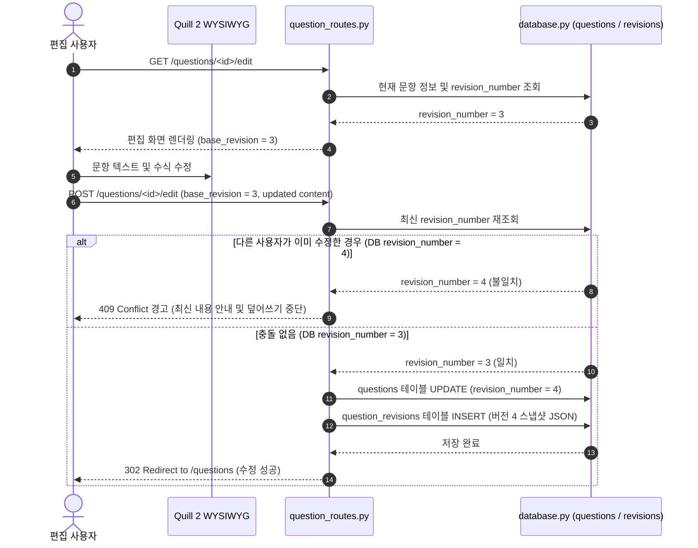

# HEXORA (헥소라) 종합 문서 - 3. 핵심 모듈 및 라우트 명세

이 문서는 HEXORA 애플리케이션의 핵심 비즈니스 모듈과 라우트 엔드포인트의 구현 로직, 보안 메커니즘 및 헬퍼 함수를 상세히 다룹니다.

---

## 1. 협업 위키 편집 및 버전 충돌 검사 시퀀스

문항 수정 시 동시 수정으로 인한 데이터 덮어쓰기를 방지하고 스냅샷 이력을 기록하는 시퀀스 흐름입니다:

---

## 2. 인증 및 보안 모듈 (`auth.py`)

`auth.py`는 사용자의 세션 관리, 회원가입, 로그인, CSRF(Cross-Site Request Forgery) 방어 및 권한 검증 데코레이터를 제공합니다.

### 2.1 CSRF 방어 메커니즘
- **`csrf_token()`**: 세션에 32바이트 보안 무작위 토큰(`secrets.token_urlsafe(32)`)을 생성 및 유지합니다.
- **`load_user_and_protect_forms()`**: `app.before_request` 후크로 등록되어, `POST`, `PUT`, `DELETE`, `PATCH` 요청 시 폼 데이터의 `_csrf_token` 또는 HTTP 헤더의 `X-CSRF-Token`을 검증합니다. 일치하지 않는 경우 `400 Bad Request`를 리턴합니다.

### 2.2 권한 검증 데코레이터
- **`@login_required(view)`**: 세션에 `user_uuid`가 없는 비인과 요청에 대해 로그인 페이지(`/login`)로 리다이렉트합니다.
- **`@admin_required(view)`**: 현재 로그인한 회원 정보의 `role`이 `admin`인지 검증하고, 그렇지 않은 경우 `403 Forbidden` 상태코드를 응답합니다.

### 2.3 회원가입 및 관리자 승격 로직 (`signup()`)
1. 입력값 검증: 이메일 형식, 이름, 비밀번호(12자 이상), 비밀번호 확인 일치 여부 확인.
2. 회원 수 카운트: 현재 등록된 전체 사용자 수를 조회합니다.
3. 최초 가입자 판별: 기존 회원 수가 `0`인 경우 해당 계정의 `role`을 **`admin`**으로 설정하고, 이후 가입 계정은 **`user`**로 등록합니다.
4. 비밀번호 암호화: `werkzeug.security.generate_password_hash`를 사용하여 단방향 해시로 저장합니다.

---

## 3. 문제 은행 및 위키 관리 모듈 (`question_routes.py`)

약 1,300줄로 이루어진 `question_routes.py`는 문제 은행의 핵심 라우트와 협업 편집, 버전 복원, 임시 저장, HTML 새니타이저 및 교육과정 매핑을 다룹니다.

### 3.1 6자리 Base36 문항 번호 포맷팅
- **`format_question_number(question_id)`**: 정수형 `question_id`를 6자리 Base36 대문자 문자열로 패딩합니다 (예: `1` -> `000001`, `36` -> `000010`, `35` -> `00000Z`).
- **`parse_question_number(value)`**: 문자열 식별자를 역으로 10진수 정수 ID로 복원하며 올바르지 않은 형식은 `None`을 반환합니다.

### 3.2 HTML 새니타이저 (`HTMLSanitizer`)
Quill 2 WYSIWYG 편집기에서 생성된 HTML 본문 내의 악성 스크립트 실행을 방지하기 위해 `html.parser.HTMLParser` 기반의 커스텀 새니타이저를 탑재하고 있습니다:
- **허용 태그**: `p`, `br`, `strong`, `em`, `u`, `ol`, `ul`, `li`, `span`, `div`, `blockquote`
- **허용 속성**: `class` (`passage-box`, `options-box` 등), `style`, `data-*` 속성
- `<script>`, `<iframe>` 등 위험 태그 및 `onclick` 등 이벤트 핸들러 속성은 자동으로 제거됩니다.

### 3.3 협업 위키 및 충돌 방지 알고리즘 (`edit_question()`)
1. **단일 원본 편집**: 모든 사용자는 기존 등록 문항을 자유롭게 수정할 수 있습니다.
2. **기준 버전(Base Revision) 검사**:
   - 편집 화면 진입 시 해당 문항의 현재 버전 번호(`revision_number`)가 `base_revision` 폼 필드에 전달됩니다.
   - 저장 시 `form.base_revision`과 DB의 실제 `revision_number`를 비교합니다.
   - 이미 다른 편집자에 의해 버전이 올라간 경우 덮어쓰기를 중단하고 충돌 에러 메시지와 함께 최신 내용을 안내합니다.
3. **스냅샷 및 수정 이력 기록**:
   - 수정이 성공하면 `_insert_question_revision()` 함수가 전체 문항 속성을 JSON 스냅샷으로 `question_revisions` 테이블에 기록합니다.

### 3.4 버전 이력 및 복원 (`question_history()`, `restore_question()`)
- **이력 조회**: 특정 문항의 전체 스냅샷 변경 내역, 편집자 정보, 수정 요약 및 시각을 목록으로 제공합니다.
- **버전 복원**: 선택한 과거 버전 번호(`revision_number`)의 스냅샷 데이터를 복원하여 새로운 버전 번호로 추가 저장합니다.

### 3.5 임시 저장(Draft) 및 개인 메모(Note)
- **Draft API**: 작성 중 브라우저 이탈 시 입력 폼 전체 데이터를 JSON 형태(`question_drafts`)로 저장하거나 자동 복원합니다.
- **Note API**: 타 회원에게 공유되지 않는 작성자 본인만의 비공개 노트(`question_notes`)를 문항별로 개별 보관합니다.

### 3.6 라우트 요약표

| 라우트 URL | HTTP 메서드 | 엔드포인트 | 주요 역할 |
| --- | --- | --- | --- |
| `/questions` | GET | `main` | 문제 DB 메인 (검색, 과목/학년 필터, 폴더 트리, 시험지 선택) |
| `/questions/new` | GET, POST | `new_question` | 새 문제 등록 (Quill 2 편집기, 임시저장 연동) |
| `/questions/<id>/edit` | GET, POST | `edit_question` | 문항 편집 (버전 충돌 방지, 수정 요약 기록) |
| `/questions/<id>/history` | GET | `question_history` | 문항 버전 변경 이력 및 Diff 조회 |
| `/questions/<id>/restore/<rev>` | POST | `restore_question` | 해당 문항을 특정 과거 스냅샷 버전으로 복원 |
| `/questions/<id>/notes` | POST | `save_question_note` | 해당 문항에 대한 비공개 개인 메모 작성/수정 |
| `/questions/<id>/folder` | POST | `move_question` | 문항을 본인의 특정 개인 폴더로 이동 |
| `/folders/new` | POST | `new_folder` | 개인 폴더 / 하위 폴더 생성 |
| `/admin/users` | GET | `admin_users` | 관리자 전용: 회원별 문항 기여 수 통계 및 필터링 |
| `/curriculum/standards` | GET | `curriculum_standards` | 학년/과목별 개정 교육과정 성취기준 JSON API |
| `/api/math/hancom-to-latex` | POST | `hancom-to-latex` | 한컴 수식 스크립트를 LaTeX 구문으로 변환하는 API |

---

## 4. 문제집 및 문항 링크 모듈 (`workbook_routes.py`)

`workbook_routes.py`는 커뮤니티 문제집, 시중 교재 정보 관리 및 문제 DB 문항과 교재 문항 간의 링크 관계를 다룹니다.

### 4.1 주요 기능 및 엔드포인트
- **`/workbooks` (`GET`, `POST`)**: 상업용/커뮤니티 문제집 등록 및 목록 조회. 발행 연도, 출판사, 교육과정, 과목 필터링 지원.
- **`/workbooks/<id>` (`GET`, `POST`)**: 문제집 상세 페이지. 해당 문제집에 수록된 문항 엔트리(`workbook_entries`) 추가, 단원/페이지/문항 번호 할당 및 문제 DB 문항 매핑.
- **`/questions/<id>/links` (`GET`, `POST`)**: 문제 DB 문항 카드에서 관련된 다른 문제(유사 문제, 변형 문제) 및 해당 문제가 수록된 문제집 페이지 연결 생성.

---

## 5. 대시보드 및 변경 이력 모듈

### 5.1 대시보드 (`dashboard_routes.py`)
- **엔드포인트**: `/` (`dashboard`)
- **역할**:
  - 공개 문제 DB의 전체 문항 수 카운트.
  - 로그인한 회원의 개인 폴더 수 카운트.
  - 과목별/단원별 문항 등록 현황 집계.
  - 최근 등록/수정된 문항 10건 목록 프리뷰.

### 5.2 앱 변경 이력 (`changelog_routes.py`)
- **엔드포인트**: `/changelog` (`changelog`)
- **동작 방식**:
  1. 원격 GitHub 저장소의 `CHANGELOG.md` 원문을 HTTP 요청(`urllib.request`)으로 먼저 조회를 시도합니다 (타임아웃 3초).
  2. 네트워크 오류 또는 GitHub 연결 불가 시 서비스 배포 버전에 동봉된 로컬 `CHANGELOG.md` 파일로 폴백합니다.
  3. 마크다운 내용을 파싱하여 버전별 변경사항(Added, Changed, Fixed 등)을 구조화된 HTML 템플릿으로 제공합니다.
