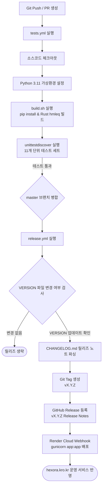

# HEXORA (헥소라) 종합 문서 - 6. 배포 및 CI/CD 워크플로

이 문서는 HEXORA 애플리케이션의 테스트 환경 구성, 배포 빌드 파이프라인(`build.sh`), Render 클라우드 배포 및 GitHub Actions 자동 릴리즈 시스템을 다룹니다.

---

## 1. CI/CD 및 자동 릴리즈 파이프라인 다이어그램

GitHub Actions 기반의 연속적 통합(CI) 및 자동 릴리즈(CD) 흐름입니다:



---

## 2. 단위 테스트 및 품질 검증

HEXORA는 standard Python `unittest` 프레임워크 기반의 회귀 테스트 체계를 갖추고 있습니다.

### 2.1 테스트 모듈 구성 (11개 파일)

| 테스트 파일 | 주요 검증 대상 |
| --- | --- |
| `tests/test_app.py` | Flask 통합 라우트, 로그인/세션, CSRF, 문제 등록/편집/삭제, 충돌 방지, 폴더 트리 |
| `tests/test_database_backends.py` | SQLite 및 PostgreSQL 어댑터 파라미터 변환(`?` -> `%s`), 인덱스/스키마 자동 생성 (외부 DB 접속 없이 단위 검증) |
| `tests/test_exam_export.py` | 문항 선택 후 HWPX 패키지 생성, 정답/해설 옵션 XML 유효성 검증 |
| `tests/test_hwp_import.py` | HWP 가져오기 폼 유효성 및 등록 흐름 검증 |
| `tests/test_hwp_routes.py` | `/hwp` 업로드 라우트 및 `/exams/export` 다운로드 엔드포인트 검증 |
| `tests/test_parse_hwp.py` | 레거시 HWPML XML 파서, 수식/선택지 정규화 검증 |
| `tests/test_rhwp_parser.py` | `rhwp-python` IR 파서 및 문단형 시험지(`1.`, `1)` 등) 폴백 파싱 |
| `tests/test_hmleq_converter.py` | `hmleq` CLI 수식 변환 및 Python 패키지 폴백 검증 |
| `tests/test_curriculum_data.py` | 학년/과목별 개정 교육과정 성취기준 데이터 매핑 검증 |
| `tests/test_versioning.py` | `VERSION` 파일 단일 원천 검증 |

### 2.2 테스트 실행 명령

```powershell
# 전체 자동 테스트 수행
python -m unittest discover -s tests -v
```

---

## 3. Render 클라우드 배포 스펙

HEXORA 공개 서비스(https://hexora.kro.kr)는 PaaS 플랫폼인 Render에 배포되어 운용됩니다.

### 3.1 빌드 스크립트 (`build.sh`)
Render의 Build Command로 지정되며, Python 의존성 및 Rust `hmleq` 수식 변환기를 자동 컴파일 및 설치합니다.

```bash
#!/usr/bin/env bash
set -euo pipefail

# 1. Python 패키지 설치
python -m pip install --upgrade pip
python -m pip install -r requirements.txt

# 2. Rust toolchain 확인 및 hmleq 설치
if command -v cargo >/dev/null 2>&1; then
  cargo install hml-equation-parser-cli || true
fi
```

### 3.2 프로세스 실행 지침 (`Procfile`)
Render의 Start Command 또는 Gunicorn 실행 명령으로 사용됩니다:

```procfile
web: gunicorn app:app
```

### 3.3 커스텀 도메인 및 DNS 설정
- **도메인**: `hexora.kro.kr`
- **DNS 레코드**:
  - TYPE `A`: `216.24.57.1` (Render Ingress IP)
  - IPv6 `AAAA`: 등록 해제
- **SSL / HTTPS**: Render TLS 자동 발급 및 갱신

---

## 4. GitHub Actions CI / CD 자동화

HEXORA는 버전 관리 단일 원천(`VERSION`)과 연동되는 GitHub Actions 워크플로를 제공합니다.

### 4.1 CI 워크플로 (`.github/workflows/tests.yml`)
- **트리거**: 모든 branch push 및 `master` 대상 Pull Request
- **수행 작업**:
  1. Python 3.11 환경 체크아웃
  2. `build.sh` 수행 (의존성 및 `hmleq` 설치)
  3. `python -m unittest discover -s tests -v` 실행하여 회귀 테스트 검증

```yaml
name: Tests
on:
  push:
  pull_request:
    branches: [master]
jobs:
  unittest:
    runs-on: ubuntu-latest
    steps:
      - uses: actions/checkout@v4
      - uses: actions/setup-python@v5
        with:
          python-version: "3.11"
      - run: bash build.sh
      - run: python -m unittest discover -s tests -v
```

---

### 4.2 CD 릴리즈 워크플로 (`.github/workflows/release.yml`)
- **트리거**: `master` 브랜치 병합 (Push)
- **자동화 절차**:
  1. `git diff`를 실행하여 이전 커밋 대비 `VERSION` 파일의 변경 여부를 확인합니다.
  2. `VERSION` 파일 내용(예: `0.1.2`)이 변경된 경우, `CHANGELOG.md`에서 해당 버전의 변경 이력(Release Notes) 섹션을 파싱 추출합니다.
  3. `vX.Y.Z` 형태로 **Git Tag**를 자동 생성하고 push합니다.
  4. 파싱된 변경 이력을 내용으로 포함하여 **GitHub Release**를 자동 등록합니다.

```yaml
name: Release Automation
on:
  push:
    branches: [master]
permissions:
  contents: write
```

---

## 5. Semantic Versioning (SemVer) 운영 규칙

프로젝트는 `VERSION` 단일 파일을 기준으로 Semantic Versioning(`MAJOR.MINOR.PATCH`)을 준수합니다.

- **MAJOR**: 데이터베이스 스키마 하위 호환성 파괴 또는 코어 버스 구조 변경 시 상향.
- **MINOR**: 새로운 라우트, 신규 파서, UI 컴포넌트 등 기능 추가 시 상향.
- **PATCH**: 버그 수정, 렌더링 스타일 수정, 문서 업데이트 시 상향.

모든 기능 단위 작업은 PR 기반으로 진행되며, PR 승인 및 병합 시 `VERSION`과 `CHANGELOG.md`가 함께 업데이트되어 자동 배포 및 릴리즈가 이루어집니다.
