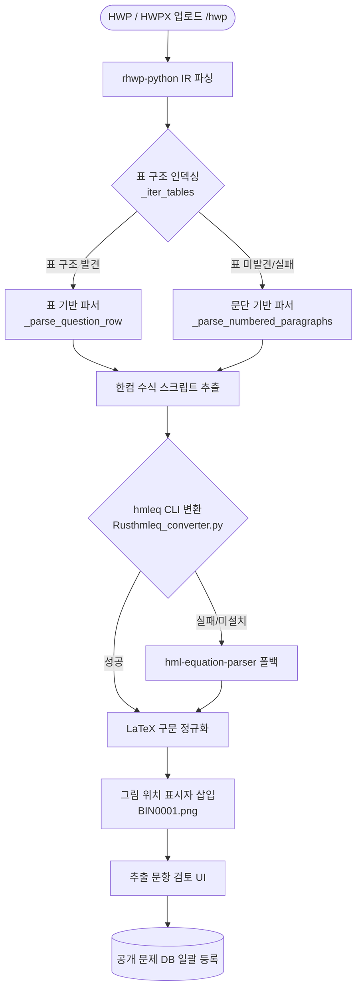
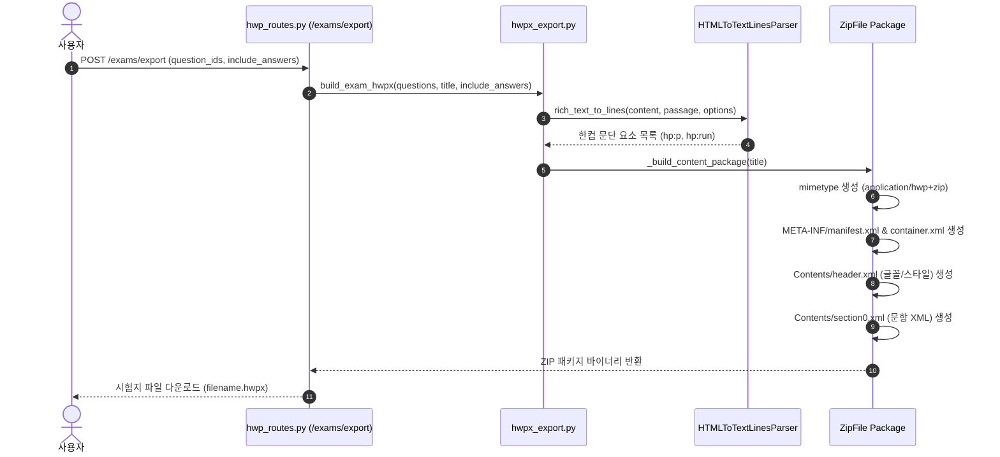

# HEXORA (헥소라) 종합 문서 - 4. HWP/HWPX 문서 파싱 및 시험지 내보내기

이 문서는 한글 문서(`.hwp`, `.hwpx`)로부터 문항 데이터를 추출하는 **파싱 파이프라인**과, 문제 DB의 선택된 문항을 HWPX 문서로 결합해 다운로드하는 **시험지 생성 파이프라인**을 상세히 설명합니다.

---

## 1. HWP / HWPX 문서 파싱 파이프라인

업로드된 문서가 표(Table) 형태인지 일반 문단(Paragraph) 형태인지에 따라 단계적 파싱 및 폴백(Fallback) 알고리즘을 적용합니다.



---

## 2. HWPX 시험지 생성 파이프라인 다이어그램

선택한 문항을 HWPX 표준 압축 컨테이너 패키지로 변환하여 다운로드하는 과정입니다:



---

## 3. 모듈별 파싱 알고리즘 세부 명세

### 3.1 `parse_rhwp.py` (메인 구조화 파서)

`rhwp-python` 라이브러리가 파싱한 문서 객체 모델(IR: Intermediate Representation)을 순회하며 다음 정밀 추출 절차를 거칩니다:

1. **위치 식별자 정렬 (`_provenance_key`)**:
   - 텍스트, 수식, 그림 블록의 문서 내 위치 순서(Section, Paragraph, Run 번호)를 기반으로 정렬 키를 생성하여 텍스트 간 문맥 순서를 정확히 유지합니다.

2. **표 기반 문항 파서 (`_parse_question_row`)**:
   - 시험지 문서의 셀(Cell)들을 분석하여 첫 번째 열이나 셀 상단에 문항 번호(예: `1.`, `[1]`, `문 1.`)가 포함되어 있는지 확인합니다.
   - 문제 본문, 보기 박스, ①~⑤ 선택지, `[정답]`, `[해설]` 키워드를 탐색해 구조화된 Dictionary 데이터로 정규화합니다.

3. **문단 기반 폴백 파서 (`_parse_numbered_paragraphs`)**:
   - 문서 전체가 표 없이 일반 문단으로 작성된 경우, 문단 첫 머리의 번호 패턴(`1.`, `1)`, `1번`, `Q1.` 등)을 식별하여 문항 구분을 나눕니다.
   - 문단 내 텍스트에서 `①`, `②`, `③`, `④`, `⑤` 번호 기호를 자동 감지하여 선택지 배열로 분리(`_split_choices`)합니다.
   - 정답이나 해설 표기가 문서 하단에 별도 표로 존재하거나 누락된 경우에도 문제 본문과 선택지를 안전하게 추출합니다.

4. **그림 인라인 보존 (`_render_picture`)**:
   - 이미지 데이터 자체는 서버 DB에 저장하지 않되, 문서 레이아웃상 그림이 위치한 곳에 `[그림: BIN0001.png]` 형태의 텍스트 위치 표시자(Placeholder)를 삽입하여 원본 문맥을 유지합니다.

---

### 3.2 `parse_hwp.py` (레거시 HWPML XML 파서)

단독 `section0.xml` 파일 또는 구형 HWPML XML 문서 처리를 위해 `xml.etree.ElementTree` 기반의 XML 직접 수식/문단 추출기를 포함합니다:

- **KaTeX 구문 정규화 (`normalize_katex_expression`)**:
  - HWPML의 수식 표현 중 `\matrix`, `\cases` 구문 및 괄호 크기 식별자(`\left`, `\right`)를 KaTeX 지원 구문으로 정규화합니다.
- **선택지 접두사 제거 (`strip_choice_label`)**:
  - 선택지 문목 앞에 붙은 `① `, `1) ` 등의 원번호 및 숫자를 제거하여 순수 선택지 내용만 추출합니다.

---

### 3.3 `hmleq_converter.py` (한컴 수식 -> LaTeX 변환기)

HWP 문서의 고유 수식 스크립트(예: `{a} over {b}`, `root {3} {x}`)를 Web/KaTeX 표준의 LaTeX 구문(`\frac{a}{b}`, `\sqrt[3]{x}`)으로 변환하기 위해 Rust CLI 도구인 `hmleq`과 프로세스 파이프라인으로 통신합니다.

```python
def convert_hmleq_script(script: str) -> str:
    # Python subprocess를 이용해 Rust hmleq CLI 실행
    result = subprocess.run(
        ["hmleq", script],
        capture_output=True,
        text=True,
        timeout=5
    )
    return result.stdout.strip()
```

- CLI가 설치되어 있지 않거나 실행 실패 시, `hml-equation-parser` Python 패키지로 폴백(Fallback)되어 수식 손실을 방지합니다.

---

## 4. HWPX 시험지 생성 파이프라인 (`hwpx_export.py`)

문제 DB에서 선택된 문항 카드 목록을 입력받아 표준 HWPX 압축 컨테이너 패키지(`.hwpx`)를 생성하는 엔진입니다.

### 4.1 렌더링 절차 및 XML 구조 생성

1. **HTML to Text Lines 변환기 (`_HTMLToTextLinesParser`)**:
   - 문제 DB의 Quill HTML 본문(`content`, `passage`, `options`)을 파싱하여, 줄바꿈, 굵게 서식, 보기 박스 레이아웃을 한컴 문단 요소(`hp:p`, `hp:run`)로 변환합니다.

2. **Section XML 구동 (`_build_section_xml`)**:
   - `Contents/section0.xml` 파일을 생성합니다.
   - 시험지 제목 문단(`para_style="19"`)을 배치하고 각 문항 번호와 본문을 순차 렌더링합니다.
   - **교사용 옵션 (`include_answers=True`)**: 문항 바로 아래에 `[정답]` 및 `[해설]` 문단을 포함시킵니다.

3. **ZIP 컨테이너 구성 (`_build_content_package`)**:
   - HWPX 사양에 맞춰 다음 구조를 `zipfile.ZipFile` 형태로 메모리에서 패키징합니다:

```
[HWPX Package Container]
├── mimetype                                (application/hwp+zip)
├── META-INF/
│   ├── container.xml                       (Rootfile 지침)
│   └── manifest.xml                        (파일 목록)
└── Contents/
    ├── content.hpf                         (패키지 매니페스트)
    ├── header.xml                          (글꼴 및 문단 스타일 정의)
    └── section0.xml                        (본문 문항 텍스트 XML)
```

4. **HTTP 파일 다운로드 라우트 (`export_exam_hwpx`)**:
   - `POST /exams/export` 요청 시 선택된 문항 ID 배열(최대 100개)과 시험지 제목을 받아 HWPX 패키지를 바이너리로 스트리밍 다운로드(`application/vnd.hancom.hwpx`)합니다.
